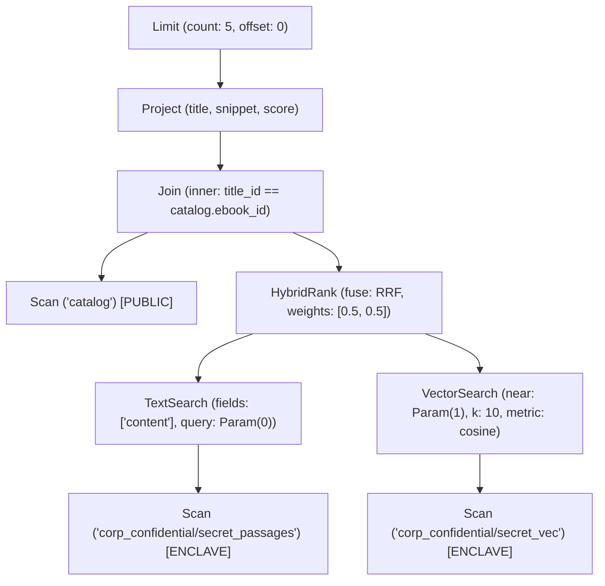

# Section 11: Query layer and stored procedures

Status: **Draft. The decisions below are confirmed; the open questions are not.**

## Purpose

This section covers how one query can reach across relational, document, vector and time-series data. It also covers what stored procedures and recipes are written in, how transactions span several stores, and how results stay within memory limits.

## Confirmed decisions

### 11.1 A structured core with our own text language on top (CMBQL)

- **Name: CMBQL (cmbql).** db-combolite's query language is named **CMBQL** (ComboLite Query Language). It encompasses both the structured operator-tree core (the canonical wire and compiled representation) and the human-readable text syntax that compiles into it.
- **Core: a structured query format.** Every query has a canonical structured representation. Agents and MCP tools build queries in this form directly.
- **Text language: new, not SQL.** CMBQL defines its own human-readable query language. It is designed to handle links, similarity, documents and time series as first-class features, not as additions bolted onto SQL. Text queries compile into the structured core.
- **The text language is an optional module.** A build can include it or leave it out.

### 11.2 Stored procedures

- Procedures are written in CMBQL, extended with control flow: variables, conditionals and loops.
- They compile to a **small bytecode of db-combolite's own design**. This bytecode is the "compiled form" stored in the catalog (Section 4.5).
- They are **sandboxed**:
  - no file access and no network access;
  - limits on instructions, time and memory, so that a faulty procedure can't stall the database.

### 11.3 Transactions across stores; conflicts

- **Atomic across stores.** A single transaction can write to several stores at once, all or nothing. For example, it can add a document, a row and a link between them. Every delta carries the transaction ID. The transaction becomes durable when its commit record is written, and replay applies only transactions that have a commit record (Sections 1.3 and 3.3). The transaction's deltas are folded into the archive together at reconciliation (Section 3.2).
- **Read your own writes.** A writer sees its own changes before they are reconciled. Every other process sees the last reconciled state (Section 5.1).
- **Write conflicts.** The policy is **configurable**. By default, if two identities edit the same entry before reconciliation, the later write is rejected and must be retried.
- **Collision notice.** A writer whose write is rejected receives a **collision notification**, much like failing to acquire a semaphore lock, so it can wait, retry or give up.

### 11.4 Combining rankings in hybrid queries

A hybrid query can combine several sources of ranking: keyword relevance (Section 8.10), vector similarity (Section 7.7), neuron weights (Section 6.6) and filters. The rankings are merged by **reciprocal rank fusion** by default. The weight given to each source can be adjusted per query, or set by the operator.

### 11.5 Streaming results and budgets

- Results are always returned **incrementally through a cursor**. A result set is never built up in full before it is returned.
- Every query runs under a **memory budget and a time budget**.

### 11.6 Triggers and schedules

A procedure can run in two ways:

- **On events (triggers)**, for example when a row is written to a particular store;
- **On a schedule, or in maintenance windows.** Recipes (Section 10.4) and maintenance work run this way.

### 11.7 Running on microcontrollers

- **Binary wire form.** The structured core has a compact **binary** encoding, so a device never needs RAM to parse JSON. JSON stays available on larger hosts.
- **Compile off the device.** Microcontroller builds leave out the text parser. Queries and procedures are compiled on a host machine and loaded onto the device already compiled.
- **Prepared queries.** Queries that are used often are stored in the catalog in compiled form and called by ID.
- **Device-class presets.** The budgets in 11.5 have default values for each device class in the table in Section 2.8.

### 11.8 What a collision notice reveals

- **Same encryption domain.** The notice names the identity that holds the conflicting write.
- **Different tenant or enclave.** The notice is opaque and names no one, so no information leaks across the boundary.

### 11.9 Trigger safety

- **Depth limit.** Each trigger has a limit on how deeply the triggers it sets off can nest. The operator configures this limit **per trigger**.
- **Triggers run after commit.** A trigger runs after the transaction that set it off has committed. Triggered work is scheduled according to the resources available.
- **Cascade warning.** If an action would set off more triggered changes than an operator-defined threshold *x*, the library warns before running it. The warning says that operational availability may be reduced until all the triggers have caught up.

### 11.10 The structured query core

- **Shape: an operator tree.** A query is a tree of typed nodes (a logical plan), not a flat pipeline or a clause object. Each node takes other nodes as input, so a query composes the way an expression does: `Sort(Limit(Filter(Scan(...), cond), n), key)`. Cross-model joins are an ordinary `Join` node whose two inputs are scans of different store kinds.
- **Read-only.** The tree only reads and ranks. Writes (insert, update, delete, link) are not tree nodes; a stored procedure's bytecode (11.2) calls the engine's existing per-model mutation functions directly, the same functions the library itself already exposes. The tree never has to define its own write ordering, conflict handling or transaction boundaries, because it never writes.
- **Scans are named by catalog name.** `Scan("orders")` names a store the way the user created it; the planner resolves the name to a store ID when the query is prepared. A compiled/prepared query (11.7) still names its store this way, so it survives the store being dropped and recreated.
- **Expressions are a tree too.** A condition, join key or sort key is itself a small expression tree: field references, literals (the shared value encoding, Section 14.6), parameters, and operators (comparison, boolean, arithmetic, and model-specific functions such as text and vector search predicates). One expression grammar is reused in every node that needs one.
- **One `Field(name)` form across every model.** `Field("price")` resolves to whatever "price" means on that scan's model: a table column, a document field (absent is null, as documents already treat a missing field), a time-series value field, or a vector collection's metadata field. A vector itself is a reserved pseudo-field, e.g. `Field("$vector")`.
- **Nested field paths use a reserved separator byte, not a literal dot.** In the structured core, a path to a nested document field is its segments joined by the ASCII Unit Separator (0x1F), not by `.`. A field name may freely contain a literal dot; nothing needs escaping, because the delimiter is never the dot character. The field dictionary (14.6) instead disallows 0x1F in a field name, which costs far less than disallowing the common case. The human-readable text language (CMBQL, Section 11.1) still writes a nested path as `address.city`; its compiler is responsible for turning that into 0x1F-joined segments (and for however it lets a user write a field name containing a literal dot — an open question for the text-language design, not the structured core).
- **Parameters.** `Param(name)` or `Param(index)` appears anywhere a literal could. The caller supplies bindings when the query runs. This is what lets one compiled, prepared query (11.7) run again with different values without recompiling.
- **Joins: inner and left-outer.** A `Join` node supports those two kinds. Right-outer is a left-outer with its inputs swapped; full-outer is left for later if it turns out to be needed, since it is just another join-kind tag and does not require a format change. The unmatched side of a left-outer join yields **null for every one of its fields**, the same null a document's missing field already produces (Section 8.1) — no second kind of absence.
- **No correlated sub-trees.** Every node's inputs are fully independent: a sub-tree (a `HybridRank` branch, a `Join`'s right input) never references a field from an enclosing node. What a `Join` or `Traverse` node already covers is enough for this database's scope (Hard constraint 4); a correlated-subquery execution and scoping model is not needed.
- **Cursor resume is an opaque token.** A cursor (11.5) hands back an opaque byte blob after each batch; the caller passes it back unexamined to continue. Its internal structure is a storage-engine detail that can change across versions without a compatibility concern, since nothing outside the engine parses it.
- **Link traversal: a `Traverse` node.** `Traverse(input, linkType, direction, hops)` walks from each entry in its input across a named link type (Section 6), forward or reverse, for one hop or a bounded range of hops. A bounded hop range covers both an ordinary one-hop join across a link and a multi-hop neuron-graph walk (Section 6.8) with the same node. Traverse's output is typically fed into a `Join` or `Scan` to pull in the linked entries' own data.
- **Hybrid ranking: a `HybridRank` node.** `HybridRank(branches, weights, fuse)` takes a list of ranked sub-trees (for example a `TextSearch` branch and a `VectorSearch` branch over the same entries) and fuses them, by reciprocal rank fusion by default (11.4). Each branch is an ordinary sub-tree, so any ranked source can be mixed in, not just a fixed pair.
- **Aggregation: a dedicated node.** `Aggregate(input, groupBy, outputs)` takes explicit grouping-key expressions and explicit aggregate output expressions (`Sum`, `Count`, and so on), rather than inferring grouping from what is left ungrouped in a projection. This keeps the tree's grouping semantics unambiguous, which matters for a clean-room format with no inherited behaviour to fall back on.
- **Wire tag scheme.** The binary form (11.7) tags every node, operator and expression kind with a single leading byte, the same style as the value encoding's type tag (14.6): one byte per kind, with room held in reserve for kinds added later without a format version bump.
- **`Project`: an explicit output list, with an optional wildcard.** `Project(input, outputs: [{as, expr}], passthrough?)` names every output field and the expression that produces it; `passthrough` additionally carries through every field already present on the input, unchanged, alongside the listed ones.
- **`Limit` carries its own offset.** `Limit(input, count, offset)` skips `offset` rows (default 0) and then yields up to `count`, covering ordinary pagination with one node.
- **`Union` never deduplicates.** `Union(branches)` concatenates every branch's stream as-is (SQL's `UNION ALL`, not `UNION`). This matches the streaming-cursor model (11.5): removing duplicates would mean buffering and comparing rows across the whole result, which a query is never required to build up in full. A caller that wants distinct rows composes that explicitly.
- **`Sort` null placement is configurable per key.** `Sort(input, keys: [{expr, dir, nulls}])`, where `nulls` is `first` or `last` per key.
- **`TextSearch` and `VectorSearch` both yield a ranked, scored stream.** `TextSearch(input, fields, query)` searches the named fields of the input's entries with the existing BM25 engine (8.10) and yields matches each carrying a relevance score. `VectorSearch(input, field, near, k, metric?)` searches a named vector field (usually `$vector`) for the `k` nearest neighbours of `near` (a literal or a `Param`), optionally overriding the collection's configured distance metric (7.7) for this one query, and yields matches each carrying a similarity score. Both shapes match, which is what lets `HybridRank` treat any ranked branch — text, vector, or otherwise — the same way.

## Open questions and design requirements for milestones M21–M23

The following gaps and design questions were identified in the CMBQL review and must be resolved as part of their respective milestone implementations:

### M21: Structured Query Core & Bytecode Engine
- **The exact binary layout of each node kind (field order, lengths)**: to be written into Section 14 once M21 implementation begins.
- **Pipeline breakers vs. bounded memory (`Sort`, `Aggregate`, `HybridRank`)**:
  - Operators like `Sort` and `Aggregate` cannot yield rows incrementally without buffering state. Under tight memory budgets (e.g. 64 KB on MCUs), the design must specify:
    1. Does exceeding memory budget immediately fail with `CDB_E_OUT_OF_BUDGET`?
    2. Are unbounded `Sort` operations disallowed without an index or a mandatory `Limit`?
    3. Or does the engine support external merge-sorting using temporary scratch pages?
- **Time-series query operators & rollup pushdown**:
  - The 12 core operators currently lack time-series primitives. M21 needs:
    1. A `Window` / time-bucketing node (`tumbling`, `sliding`, `hopping`) for metric streams.
    2. An `AsofJoin` node to join event records with the most recent preceding time-series metric point.
    3. Rollup pushdown: allowing `Aggregate` or `Scan` to query pre-aggregated chunk summaries in `cdb_ts.c` without decompressing raw tick samples.
- **Graph traversal (`Traverse`) semantics**:
  - **Cycle detection**: Bounded-memory visited-set tracking (e.g., fixed-capacity bloom filter or ring buffer) vs. depth-limited termination.
  - **Output schema**: Defining whether `Traverse` emits target entry references only, or full path tuples `(source_id, depth, target_id, edge_properties)`.
  - **Traversal pruning**: Supporting edge-property predicate pushdown to prune graph exploration paths at traversal time rather than filtering downstream.
- **Document unnesting (`Unnest`)**:
  - An operator node to explode arrays from document fields or Nibblet records into discrete stream items for joining and filtering.
- **Cross-model type coercion and NULL semantics**:
  - Explicit comparison rules between strongly-typed table columns and schemaless document/Nibblet fields.
  - Tri-state boolean logic (`TRUE`, `FALSE`, `UNKNOWN`/`NULL`) for absent document fields in boolean expressions.
- **Stored-procedure bytecode instruction set architecture (ISA)**:
  - Register vs. stack evaluation architecture, control flow jump opcodes, variable storage slots, instruction-budget decrementing hooks, and host-API mutation call dispatch with error status propagation.

### M22: Text Query Language (CMBQL)
- **Grammar & Lexer (EBNF)**:
  - Formal grammar definition for human-readable queries (`QUERY ... SELECT ...`) and stored procedures (`PROCEDURE ...`).
- **Literal dots vs. nested field path resolution**:
  - Syntax rules allowing field names containing literal dots to be escaped (e.g., via backticks or quotes) and disambiguated from nested document path navigation (which compiles to `0x1F` Unit Separator bytes in the structured core).
- **Procedural variable scoping & subquery materialization**:
  - Scoping rules for procedural variables (`LET $var = ...`) and defining when query expressions assigned to variables are materialized versus streamed.

### M23: Transactions, Coordination & Triggers
- **Cursor isolation during intra-transaction mutations**:
  - Defining isolation and reentrancy guarantees when a procedure iterates a stream cursor while performing concurrent writes (`INSERT`, `LINK`, `APPEND`) to tables or indexes being scanned.
- **Procedure error trapping & savepoints**:
  - Error-handling model within stored procedures: whether any failed mutation (e.g. constraint violation) immediately aborts the transaction, or if savepoints / rollback-to-savepoint primitives are provided.

## Appendix: Worked Examples (Referenced to GutenFree Diet Demo)

This appendix illustrates the CMBQL language and execution model through concrete worked examples based on the data architecture of the **GutenFree Diet** demonstration application (`demo/gutenfree/`).

### A.1 Unencrypted Multi-Model Ingestion (GutenFree Diet Pipeline)

The GutenFree Diet application integrates all five db-combolite engine models:
- **Relational Table (`catalog`)** (`demo/gutenfree/gf_catalog.c`): Row-oriented table tracking book metadata (`ebook_id`, `title`, `author`, `language`, `issued`) with primary key and secondary indexes.
- **Document Pool (`passages`)** (`demo/gutenfree/gf_books.c`): Document pool storing ~2 KB passages with automatic BM25 full-text indexing (`cdb_fts.c`).
- **Vector Collections (`passage_vec`, `book_vec`)** (`demo/gutenfree/gf_vec.c`): 384-dimensional dense vectors (F32) with a neighbour graph (`cdb_vec.c`).
- **Graph Links (`similar_to`)** (`demo/gutenfree/gf_vec.c`): Many-to-many links (`cdb_link.c`) joining similar books and passages based on vector cosine similarity.
- **Time Series (`metrics`)** (`demo/gutenfree/gf_metrics.c`): Column-compressed series (`cdb_ts.c`) logging ingestion metrics and diagnostics.

#### CMBQL Ingestion Procedure

Because network downloads and model inferences run outside the database sandbox (Section 11.2), the host process retrieves text and generates embeddings, then executes this CMBQL procedure within an atomic transaction:

```sql
PROCEDURE ingest_gutenberg_book(
    $ebook_id    INT,
    $title       STRING,
    $author      STRING,
    $language    STRING,
    $passages    ARRAY,   -- Array of { seq: INT, text: STRING, vector: VECTOR(F32, 384) }
    $book_vector VECTOR(F32, 384),
    $client_id   STRING
)
BEGIN TRANSACTION;
    LET $start_time = clock_now();

    -- 1. Relational Table (cdb_table.c)
    -- Insert metadata into the catalog table; checks PK and unique constraints.
    INSERT INTO TABLE catalog (
        ebook_id,
        title,
        author,
        language,
        downloads,
        indexed_at
    ) VALUES (
        $ebook_id,
        $title,
        $author,
        $language,
        0,
        $start_time
    );

    -- 2. Document Pool + Full-Text Search (cdb_doc.c, cdb_fts.c)
    -- 3. Vector Collections & Neighbour Graph (cdb_vec.c)
    -- Insert each passage as a document and its embedding into the vector space.
    LET $passage_refs = [];

    FOR $p IN $passages DO
        -- Document pool insert triggers built-in BM25 delta index update.
        LET $doc_ref = INSERT INTO POOL passages {
            ebook_id: $ebook_id,
            seq:      $p.seq,
            text:     $p.text
        };
        $passage_refs.push($doc_ref);

        -- Dense vector insert with source tracking back to the document entry.
        INSERT INTO VECTOR passage_vec (
            $vector,
            source_ref
        ) VALUES (
            $p.vector,
            $doc_ref
        );
    END FOR;

    -- Insert overall book embedding
    LET $book_vec_ref = INSERT INTO VECTOR book_vec (
        $vector,
        source_ref
    ) VALUES (
        $book_vector,
        REF(catalog, $ebook_id)
    );

    -- 4. Keys & Links (cdb_link.c)
    -- Use CMBQL VectorSearch operator to find nearest neighbours, then link them.
    LET $similar_books = (
        SELECT $target_ref
        FROM VectorSearch(
            Scan("book_vec"),
            Field("$vector"),
            near: $book_vector,
            k: 5,
            metric: "cosine"
        )
        PROJECT {
            $target_ref: Field("source_ref"),
            similarity:  Field("$score")
        }
        FILTER Field("similarity") >= 0.82
           AND Field("$target_ref") != REF(catalog, $ebook_id)
    );

    FOR $sim IN $similar_books DO
        LINK REF(catalog, $ebook_id)
          TO $sim.$target_ref
        TYPE "similar_to"
        PROPERTIES { score: $sim.similarity };
    END FOR;

    -- 5. Time Series (cdb_ts.c)
    -- Record ingestion telemetry.
    LET $duration_ms = (clock_now() - $start_time) / 1000000;

    APPEND TO TIMESERIES ingest_metrics (
        timestamp,
        tags: {
            ebook_id: $ebook_id,
            client:   $client_id
        },
        values: {
            passage_count: $passages.length,
            duration_ms:   $duration_ms,
            status_code:   200
        }
    );

COMMIT;
```

#### Under-the-Hood Execution
- **Multi-Store Atomicity (Section 11.3)**: All mutations share one transaction ID across all five companion stores.
- **Journal Records**: Relational insert emits `CDB_RECORD_DATA` plus `CDB_RECORD_WRITE_KEY` for the primary key. Document, vector, link, and time-series mutations append their respective delta records.
- **Commit Coordination (M19, Section 5.9.4)**: `cdb_tx_commit` issues `CDB_RECORD_PREPARE`, pauses for the settle window, verifies no collision across peer journals on entry-IDs or unique keys, and seals the commit. Power loss at any instant leaves the prior archive commit intact with zero partial state leaked.

---

### A.2 Encrypted Enclave Ingestion and Cross-Boundary Query

This example examines the scenario where a proprietary or classified title must reside within an **Encrypted Enclave** (Sections 1.4, 4.4, 12).

#### Threat Model and Enclave Invariants
1. **Cryptographic Secrecy (Section 12.5.1)**: Protection does not depend on software access-control checks in public catalogs. Enclave pages and deltas are encrypted with authenticated encryption (AES-256-GCM or ChaCha20-Poly1305, Section 12.1) under an enclave key (`vault://...`). Without the key, pages cannot be decrypted.
2. **Deterministic Nonces (Section 12.1)**: Nonces are built from `(track_id, seq)` where sequences are durably reserved before writes, guaranteeing zero nonce reuse.
3. **Keyed Content Hashes (Section 6.3)**: Deduplication and content hashes inside an enclave are keyed with an HMAC derived from the enclave key. An unauthorized user cannot hash a known text and probe the database to verify if the secret document exists.
4. **Cross-Boundary Opaque Pointers (Section 4.9, 6.11)**: Links connecting the public catalog to the confidential enclave reside in a **joined store** and store only an **opaque pointer** (`enclave_ptr`), revealing neither the secret store name nor its internal layout.
5. **Collision Privacy (Section 11.8)**: In multi-process concurrency, collision notifications spanning an enclave boundary are anonymized and reveal no identity or tenant information.

#### CMBQL Confidential Ingestion Procedure

```sql
PROCEDURE ingest_confidential_title(
    $title_id     INT,
    $public_stub  STRING,          -- Public stub, e.g. "Project X (Redacted)"
    $passages     ARRAY,           -- Encrypted proprietary text & vectors
    $enclave_uri  STRING           -- e.g. "vault://secrets/keys/corp_confidential"
)
BEGIN TRANSACTION;
    -- Authenticate and bind the enclave key for this session
    ENCLAVE OPEN "corp_confidential" KEY PROVIDER $enclave_uri;

    -- 1. Insert a public stub in the unencrypted catalog
    LET $pub_ref = INSERT INTO TABLE catalog (
        ebook_id,
        title,
        author,
        is_restricted
    ) VALUES (
        $title_id,
        $public_stub,
        "Confidential Author",
        TRUE
    );

    -- 2. Insert into the ENCLAVE's private document pool & vector collection
    -- All pages, BM25 postings, and vector indexes are encrypted on disk.
    FOR $p IN $passages DO
        LET $secret_doc = INSERT INTO ENCLAVE "corp_confidential" POOL secret_passages {
            title_id: $title_id,
            section:  $p.section,
            content:  $p.classified_text
        };

        INSERT INTO ENCLAVE "corp_confidential" VECTOR secret_vec (
            $vector,
            source_ref
        ) VALUES (
            $p.vector,
            $secret_doc
        );
    END FOR;

    -- 3. Cross-boundary link stored in a joined store via opaque pointer (Spec 6.11)
    LINK $pub_ref TO ENCLAVE "corp_confidential" REF(secret_passages, 1)
    TYPE "restricted_body"
    VIA JOINED_STORE;

COMMIT;
```

#### CMBQL Confidential Retrieval Query (Hybrid Ranking)

An authorized analyst searches across both the confidential enclave and the public catalog:

```sql
QUERY search_with_enclave($query_text STRING, $query_vector VECTOR(F32, 384))
WITH ENCLAVE "corp_confidential" KEY "vault://secrets/keys/corp_confidential"
SELECT 
    title,
    snippet,
    score
FROM HybridRank(
    branches: [
        TextSearch(
            Scan("corp_confidential/secret_passages"),
            fields: ["content"],
            query: $query_text
        ),
        VectorSearch(
            Scan("corp_confidential/secret_vec"),
            Field("$vector"),
            near: $query_vector,
            k: 10,
            metric: "cosine"
        )
    ],
    weights: [0.5, 0.5],
    fuse: "rrf"
)
JOIN Scan("catalog") 
  ON Field("catalog.ebook_id") = Field("title_id")
PROJECT {
    title:   Field("catalog.title"),
    snippet: Field("content"),
    score:   Field("$score")
}
LIMIT 5;
```

#### Structured Operator Tree (Wire Representation)

The structured core compiles this query into a logical operator tree:



#### Security Enforcement Matrix

| Layer / Mechanism | Authorized Principal (Holds Enclave Key) | Unauthorized Caller (No Enclave Key) |
|---|---|---|
| **Storage & Pager (`cdb_pager.c`)** | Authenticates nonce `(track_id, seq)` and decrypts pages in caller-provided buffers via AES-256-GCM. | Cryptographic rejection (`CDB_E_PERMISSION`); ciphertext cannot be decrypted. |
| **Enclave Scan Node** | Iterates over decrypted entries through the cursor. | Scan fails immediately; returns empty stream or permission error. |
| **Joined Store Links** | Follows the opaque pointer into the enclave target entry. | Pointer cannot be resolved; yields null/tombstone. |
| **Search Indexes (BM25 / Vectors)** | Searches term postings and traverses the vector neighbour graph within the enclave. | Index pages are encrypted ciphertexts; cannot be searched, scanned, or probed. |
| **Memory Hygiene (Section 12.6)** | Decrypted buffers and keys are scrubbed (`explicit_bzero`) as soon as the query cursor closes. | Plaintext never enters memory. |
| **Deduplication (Section 1.6)** | Deduplicated solely within this enclave's private domain. | Cannot infer whether an encrypted document matches any public document. |
